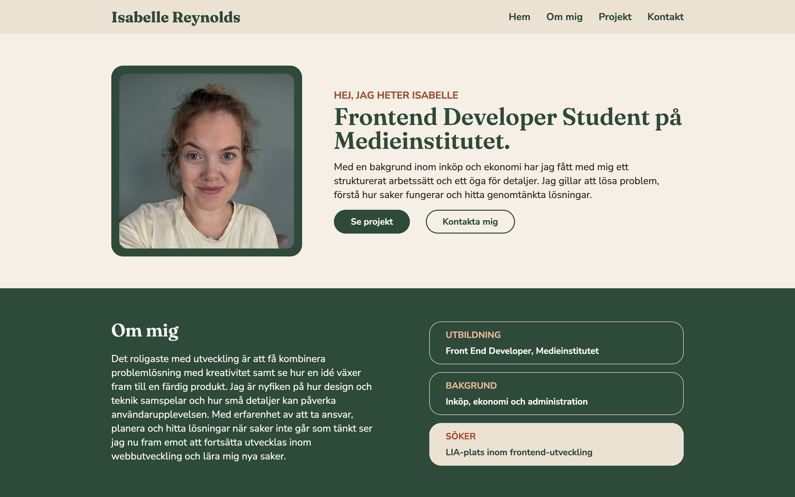
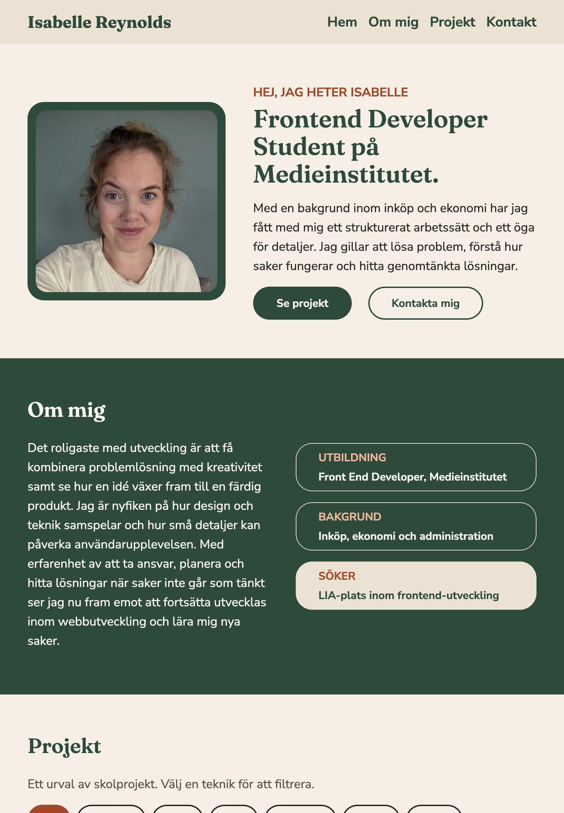
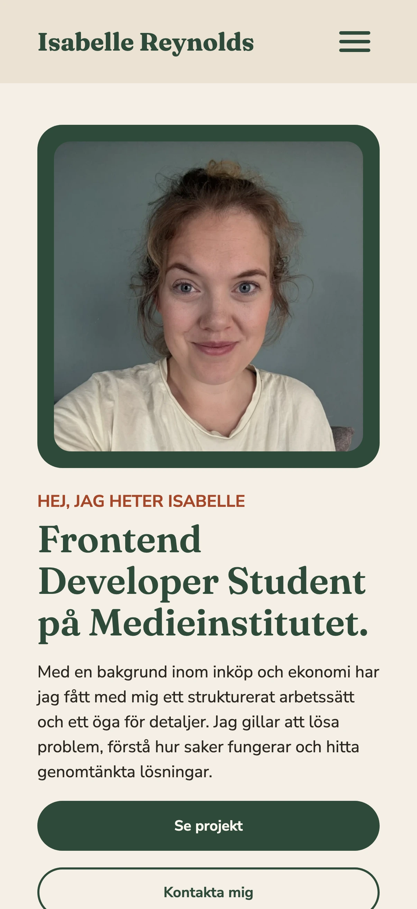
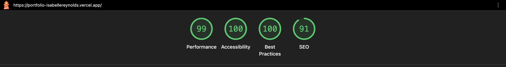
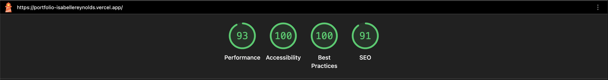

# Portfolio

## Om projektet

Inlämningsuppgift där jag byggde en personlig portfolio som en React-baserad single page application. Sidan presenterar mig, min bakgrund och utbildning samt sex projekt som kan filtreras efter teknik. Webbplatsen är responsiv och anpassad för skärmar från 360 px upp till desktop.

**Live-sida:** [portfolio-isabellereynolds.vercel.app](https://portfolio-isabellereynolds.vercel.app/)

**Design:** [Figma-skiss (mobil, tablet och desktop)](https://www.figma.com/proto/9HcjT32lls5H7nsfpZqPCG/Portfolio?node-id=0-1&t=uTTszBWChDCecVko-1)

## Teknik

**💻 Utveckling**

   

**🎨 Design**


**🛠️ Verktyg**


**🚀 Versionshantering & driftsättning**

  

## Funktioner

- Single page-layout med sektionerna Hem, Om mig, Projekt och Kontakt samt ankarnavigation mellan dem
- Responsiv mobilmeny som låser sidans scroll när den är öppen
- Projektkort som renderas från en separat datafil med `.map()` och `key`
- Filtrering på teknik, där den filtrerade listan räknas fram vid rendering i stället för att sparas i state
- Delade layoutklasser (`section-padding`, `container-page`) för enhetliga avstånd i alla sektioner

## Skärmdumpar

**Desktop**


**Tablet**


**Mobil**


## Tillgänglighet

**Desktop**


**Mobil**


## Köra projektet lokalt

För att köra projektet lokalt behöver du ha Node.js och npm installerat. Använd en Node.js-version som stöds av Vite 8.

### 1. Klona repot

```bash
git clone https://github.com/isabelletherese/portfolio.git
cd portfolio
```

### 2. Installera beroenden

```bash
npm install
```

### 3. Starta utvecklingsservern

```bash
npm run dev
```

Öppna adressen som visas i terminalen i din webbläsare. Som standard är det `http://localhost:5173`.

### Tillgängliga script

| Kommando          | Beskrivning                                                        |
| ----------------- | ------------------------------------------------------------------ |
| `npm run dev`     | Startar utvecklingsservern.                                        |
| `npm run build`   | Kontrollerar TypeScript-koden och bygger projektet för produktion. |
| `npm run preview` | Förhandsvisar produktionsbygget lokalt.                            |
| `npm run lint`    | Kontrollerar koden med ESLint.                                     |
| `npm run format`  | Formaterar filerna i `src` med Prettier.                           |

## Projektstruktur

```
src/
├── components/   # Navbar, Hero, About, Projects, Filters, ProjectCard, Contact, Footer
├── data/         # projects.ts – projektdata och filtertaggar
├── assets/       # bilder
├── types.ts      # delade typer (Project, Filter)
└── index.css     # Tailwind-tema, basstilar och delade klasser
```

## Ändringar mot Figma-skissen

- Lagt till fler filterknappar för att göra det möjligt att filtrera projekten efter fler tekniker.

- Ökat knapparnas storlek för att förbättra användbarheten och tillgängligheten.

- Justerade färgerna på rubrikerna i kontaktsektionen för att förbättra kontrasten och det visuella uttrycket.

- Ökade textstorleken och använde en kraftigare textvikt för att förbättra läsbarheten.
